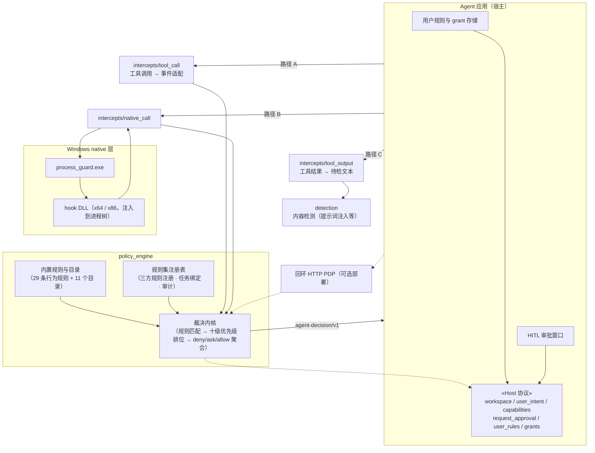
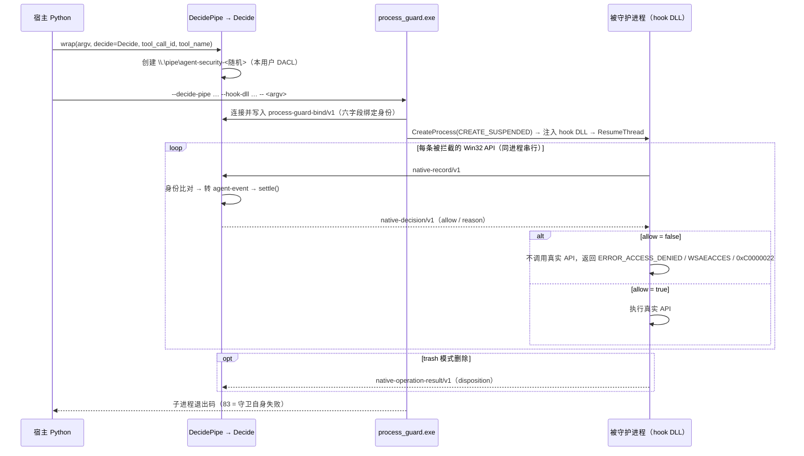
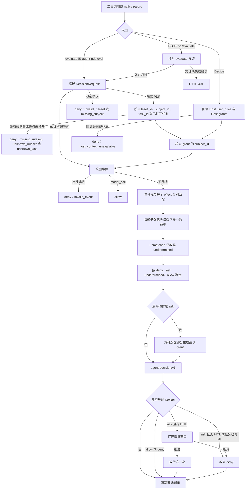

# agent_shield 设计文档

## 1. 引言

### 1.1 背景与问题

Agent 运行时把模型输出变成真实动作：执行命令、读写文件、访问网络、创建子进程。面对的风险包括：

- **越权执行**：注入指令诱导 Agent 执行危险命令——提权、强制推送、混淆命令、远程脚本；
- **数据外发**：把密钥、令牌或敏感文件发送到外部端点；
- **路径越界**：读写工作区之外的用户文件、受保护系统文件、设备与命名管道；
- **驻留**：创建定时任务等持久化手段；
- **规避**：命令在静态解析层被伪装（解码管道、引号技巧），绕过纯文本检查。

`agent_shield` 的定位是 **Agent 全流程的多层安全护栏**，覆盖五条安全相关流：用户输入输出、模型输入输出、工具（含系统层事件）执行、工具输出、skill 安装。当前由三层组成：

1. **`intercepts/`——接入层（拦截点）**：把流经点编成事件或检测请求，再调用对应引擎。已落地三个接入点：`tool_call`（工具调用）、`native_call`（进程树系统调用）、`tool_output`（工具结果）；用户输入输出、模型输入输出、skill 安装是预留接入点（未落地，不建空目录）；
2. **`policy_engine/`——行为策略引擎**：对文件、工具、命令、网络四类行为给出 `allow`、`ask`、`deny` 或 `undetermined` 之一。工具调用在解析层拦截（命令不执行），系统调用在执行前拦截（拒绝则该 API 不执行，fail-closed）；
3. **`detection/`——内容检测引擎**：对进入模型或工具结果的内容做提示词注入等检测，输出概率性软信号；`tool_output` 接入点调用它。

行为决策与内容检测分工：行为引擎管「**能不能做**」（fail-closed 的动作裁决），检测引擎管「**内容里有什么**」（注入与敏感内容信号）。`tool_permission/` 是仓库内既有的动作决策组件（W1a/W2/W3/W6），不并入上述两层。本文档聚焦接入层与行为策略引擎；`detection` 与 `tool_permission` 由各自文档描述（见 12）。

### 1.2 设计目标

1. **统一裁决**：一次工具调用或一条 native record，产出恰好一个决定（`agent-decision/v1` 信封）。
2. **结构性安全**：deny 永不被任何 allow 翻转；内置/三方 ask 永不被宽匹配的用户 allow 压过——由固化的优先级表保证，不依赖运行时判断。
3. **四层规则、十级优先级**：内置 / 三方 / 用户自定义 / 用户交互授权（grant）四层来源在同一张优先级表上裁决。
4. **精确授权**：HITL 审批沉淀的 grant 只覆盖本次的精确资源；不可沉淀的 ask 不提供「总是允许」。
5. **失败关闭（fail-closed）**：规则加载失败、任务未打开、宿主回调失败、native 管道或注入不可用，一律 deny 或拒绝执行，绝不退回裸进程或空规则。
6. **宿主解耦**：引擎不 import 任何 Agent 框架；宿主通过 `Host` 协议提供上下文与审批窗口；引擎不落盘任何外部规则或 grant。
7. **审计完整**：注册、更新、每次裁决、每次 grant 采纳/剔除、native 结算全部留痕。

### 1.3 非目标

- **不是隔离边界**：进程守卫只做行为决策，不做资源隔离；沙箱是 `jiuwenbox` 的职责。`execution.plane=sandbox` 不降低任何风险档。
- **不抵御同进程恶意代码**：trusted in-process 部署的安全边界是宿主进程本身；同进程代码可以直接改写参数。
- **不做静态行为分析之外的语义理解**：意图核对是纯文本匹配（见 4.8），不调用模型。
- **不落盘规则**：三方规则集、用户规则、grant 只存在于引擎内存与宿主存储中。

### 1.4 范围与模块清单

```
agent_shield/                       ← 本目录自身即 agent_shield 包（flat 布局，
  README.md                            pyproject 的 package-dir 把根映射为 agent_shield）
  docs/agent_shield-design.md        本设计文档
  policy_engine/                策略决策点（引擎 + 服务）
    evaluate.py                 公开 evaluate()
    audit.py                    文件审计（JSONL）
    errors.py                   规则加载失败（PolicyError）
    matchers/                   路径、网络、命令、工具与行为规则；dispatch 分发对象规则
    models/                     规则对象（BehaviorRule / ObjectRule）
    core/                       规则集加载、裁决编排、聚合
    builtin/                    随包行为规则、目录表与策略快照
    events/                     工具调用和 native record 共用的事件构造
    server/                     Decide / Host / RulesetRegistry / 回环 HTTP / CLI
  intercepts/                       接入层（拦截点）：把流经点编成事件或检测请求
    tool_call/                        工具调用 → 行为策略引擎
      adapters/jiuwenswarm/tool_call.py 工具调用 → 事件
    native_call/                      进程树系统调用 → 行为策略引擎（原 process_guard Python 侧）
      launch.py / decide_pipe.py          preflight 与 wrap / Decide 管道
      record.py / session.py              native record → 事件 / 绑定身份与结算
    tool_output/                      工具结果 → 内容检测引擎
      inspect.py                          异步 inspect()：文本交 detection 后端评估
      adapters/jiuwenswarm/tool_result.py 从工具结果提取待检文本
  native/windows-process-guard/  C/C++ 原生实现（Detours hook + 守护进程）
    src/  tests/  third_party/detours/（构建期外置 checkout，非 submodule）  build.ps1  python/（二进制分发子包）
  schema/                        7 个 JSON Schema
  tests/                         Python 单元测试 + e2e（见 13.1）
```

同仓还有两个**范围外**的兄弟子包：`detection/`（内容检测引擎——提示词注入等检测，被 `intercepts/tool_output` 调用）与 `tool_permission/`（既有动作决策组件：toolguard/fileguard/netguard/hostguard/delguard）。它们与本文档的组件同包名空间、分开演进，由各自的文档描述，本文档不展开（见 12）。

### 1.5 术语表

| 术语 | 含义 |
|---|---|
| PDP | Policy Decision Point，策略决策点，即 `policy_engine` 包 |
| 接入点（intercept） | `intercepts/` 包内把一条流经点（工具调用、系统调用、工具结果）编成事件或检测请求的组件 |
| 宿主（Host） | 集成 agent_shield 的 Agent 应用运行时，持有用户规则与 grant，提供审批窗口 |
| 主体（`subject_id`） | 宿主为当前用户/profile 填写的隔离键，grant 按它隔离 |
| 任务（`task_id`） | 宿主生成的任务标识，与 `ruleset_id`、`subject_id` 组成任务绑定三元组 |
| 规则集（`agent-pdp/v1`） | 三方配置：对象规则、目录追加、行为覆盖、`action_mapping`。经规则集接口注册 |
| 事件（event） | `agent-event/v1`，一次工具调用或一条 native record 的规范化描述 |
| effect | 事件拆出的原子行为：`process.exec`、`fs.*`、`net.*`、`privilege.escalate`、`schedule.create` |
| 行为规则 | 按风险档描述的行为分类，动作由风险换算 |
| 对象规则 | 直接声明 allow/ask/deny 的五类对象规则（file/domain/command/agentTools/nativeTools） |
| 目录（catalog） | 可被规则引用的名单数据（路径、glob、主机、CIDR、程序名等） |
| grant | HITL 审批沉淀的精确资源授权，仅 allow，位于优先级位置 4 |
| HITL | Human-in-the-loop，宿主打开的审批窗口 |
| `unmatched` | 宿主启动时设定的无命中改写策略（none/allow/ask/deny） |
| native record | `native-record/v1`，hook 层上报的一次被拦截 API 调用 |
| 回环 PDP | `agent-pdp serve` 启动的独立 HTTP PDP 进程，只监听本机回环 |

---

## 2. 总体架构

### 2.1 组件视图

一个 Agent 应用运行**自己的**一台引擎，加载该应用的一份三方配置；另一个应用运行另一台引擎。同一应用里的多个主体共用这份配置，用 `subject_id` 隔离 grant。一个进程的注册表可以同时持有多个 `ruleset_id`（供同应用隔离与测试），但多个应用不放进同一个进程。



宿主不是引擎的组件，而是**集成引擎的 Agent 应用运行时**。引擎不 import 任何 Agent 框架，只依赖 `Host` 协议（`policy_engine/server/host.py`，6 个方法的 Python `Protocol`）。谁来集成引擎，谁就实现这个协议——jiuwen 实现一份、LangChain 实现一份、测试代码实现一份（`tests/policy_engine/server/support.py` 的假 Host）。图中虚线箭头表示引擎在裁决过程中经 Host 协议回调宿主获取上下文与审批。

图中两条路径最终汇入同一个裁决内核：

| 路径 | 入口 | 拦截层 | 数据流 |
|---|---|---|---|
| **A · 工具调用** | `evaluate(request)` 或 `POST /v1/evaluate` | 解析层（命令不执行） | 宿主 → intercepts/tool_call 适配成 `agent-event/v1` → 引擎裁决 |
| **B · native 拦截** | `Decide.settle()` | 系统调用执行前 | hook DLL 拦截 API → `native-record/v1` → intercepts/native_call 转事件 → 引擎裁决 |
| **C · 工具输出检测** | `inspect(tool_name, text)`（异步） | 内容层（旁路软信号） | 宿主 → intercepts/tool_output 提取文本 → detection 评估，返回 `RiskAssessment`，不产决定信封 |

路径 A/B 与路径 C 的产出不同：行为引擎产出 fail-closed 的动作裁决（`agent-decision/v1`），检测引擎产出概率性软信号（`RiskAssessment`，由宿主决定如何消费——展示、降权或转人工）。

三层规则来源都汇入裁决内核：

- **内置规则与目录**（`builtin`）：引擎自带，不可删除、不可经接口修改，是安全底线。
- **三方规则**（经 `registry` 注册的 `agent-pdp/v1` 规则集）：宿主注册，版本化管理。覆盖内置行为时风险不得低于 floor。
- **用户规则与 grant**（`store`）：宿主按主体持有，每次请求随 `DecisionRequest` 或 `Host` 回调传入。

进程内调用与回环 HTTP 走同一套裁决，决定信封都是 `agent-decision/v1`。隔离 PDP 只监听本机回环，evaluate 凭证与控制凭证分开。native 层拿到的决定是 `native-decision/v1`：`allow=false` 时这次 API 不执行。

### 2.2 三条端到端路径

**路径 A：工具调用（Agent 侧，拦截在解析层）。**

1. Agent 发起工具调用，宿主用适配器（`policy_engine/events/`，或 `intercepts/tool_call/adapters/jiuwenswarm/tool_call.py`）把调用规范化为 `agent-event/v1` 与 effect 列表。命令解析**绝不执行命令**。
2. 宿主组装 `DecisionRequest`（`ruleset_id`、`subject_id`、`task_id`、事件、`user_rules`、`grants`）。
3. 调用进程内 `evaluate(request)`，或经回环 PDP `POST /v1/evaluate`。
4. 引擎校验请求与事件，四层规则同场匹配，十级优先级聚合，产出 `agent-decision/v1`。
5. 最终动作为 `ask` 时由宿主打开 HITL 审批窗口：批准放行这一次，拒绝收成 deny；可沉淀的 ask 随决定返回建议 grant，由宿主选择保存并在后续请求携带。

**路径 B：native 拦截（系统调用层，拦截在执行前）。**



子进程与任意深度的孙进程同样被守护：hook 拦截 `CreateProcess` 族 API，先询问裁决，再经 broker 管道请求 `process_guard.exe` 对新进程重新注入（见 9.3）。`tool_call_id`/`tool_name` 沿进程树继承，写入每条 record 的 `cause`。

**路径 C：工具输出检测（内容层，旁路软信号）。**

1. 宿主拿到一次工具调用的结果，调用 `inspect(tool_name, text)`（`intercepts/tool_output/inspect.py`，异步）；
2. 适配器 `tool_result_text`（`adapters/jiuwenswarm/tool_result.py`）从结果里取文本：纯字符串直接用；字典依次找 `content`/`output`/`text`/`result` 键；其余为空串；
3. `inspect` 把文本连同 `tool_name` 组成 `GuardrailContext`（event=`tool_output`），交给 detection 的后端（默认 `RuleBasedPromptInjectionBackend`，可经 `backend=` 参数注入）；
4. 后端返回 `RiskAssessment`——这是**概率性软信号**，不是动作裁决：宿主自行决定消费方式（展示、把结果降权、转人工确认），不影响 `agent-decision/v1` 的产生。

路径 C 不经过任务绑定、规则集与 Host 协议；`detection` 的内部（后端族、解析器、风险模型）由其自身文档描述。

### 2.3 部署形态

| 形态 | 入口 | 说明 |
|---|---|---|
| trusted in-process | `evaluate(request)`（库嵌入宿主进程） | 安全边界是宿主进程；不抵御同进程改写 |
| isolated PDP | `agent-pdp serve`（独立进程，回环 HTTP） | `POST /v1/evaluate` 需 evaluate 凭证；控制端点需控制凭证 |
| native 结算 | `Decide`（宿主构造，任务级） | 每条 native record 回调宿主 `Host.user_rules()` / `Host.grants()` |

工具输出检测（路径 C）没有独立部署形态：`inspect()` 是进程内异步函数，与 detection 后端同进程调用，不监听端口、不落凭证。

`agent-pdp eval` 是一次性 CLI 入口：从 stdin 读一个 DecisionRequest，按内置规则裁决；`--policy` 给出这一次使用的三方规则集，不查任务，也不和已注册的规则集合并。

### 2.4 信任边界

- **进程内**：只有同进程宿主调用 `evaluate(request)` 或构造 `Decide`。缺 `subject_id` 时 deny（`missing_subject`）；裸事件 deny（`invalid_ruleset`）。
- **回环 PDP**：只允许绑定 `127.0.0.1`、`localhost`、`::1`（`http.py` 的 `_LOOPBACK` 名单，非回环直接 `ValueError`）。启动时用 `secrets.token_urlsafe(32)` 生成 evaluate 与控制两份凭证，只留在进程内存；CLI 把 `{"url", evaluate_token, control_token}` 单行 JSON 打到 **stderr**，不写文件、环境变量或工作区。凭证经 `Authorization: Bearer` 或 `X-Agent-PDP-Token` 提交，比较用 `hmac.compare_digest`；缺失或错误返回 401，不进入裁决。`X-Agent-PDP-Caller` 是可选审计标签（省略记空字符串），不是凭证。
- **宿主与 Agent 分离**：Agent 的工具子进程受 PDP 管控；grant 由宿主持有，引擎不保存、不签发 MAC、不解释有效期。`subject_id` 不一致的 grant 被剔除并审计。已认证宿主同时改写 `subject_id` 与 grants 仍在调用方信任边界内。
- **native 管道**：Decide 管道与 broker 管道的 DACL 仅授予当前用户 SID（`D:P(A;;GA;;;<sid>)`）并设置 `PIPE_REJECT_REMOTE_CLIENTS`；启动配置经本用户 DACL 保护的文件映射传递；句柄不继承，靠 `DuplicateHandle` 精确投递。每个连接先收 `process-guard-bind/v1` 绑定记录，之后每条 record 都要过六字段身份比对（见 8.3），未绑定或不匹配即 deny。

---

## 3. 数据模型

### 3.1 事件与 effect（`agent-event/v1`）

事件描述「被评估的行为」。裁决读取的主要字段：

| 字段 | 用途 |
|---|---|
| `id`、`time` | 决定里的 `event_id`；建议 grant 的 `decision_id` 与 `approved_at` |
| `action.category` | `model_call` 直接放行；其余进入匹配 |
| `action.raw.name` | agentTools 只比较这个工具名（大小写不敏感）；native 事件为 `native`，不参与 agentTools 匹配 |
| `action.command_line` / `command_tokens` | 命令行原文与空白分词；对象 command 规则的匹配键 |
| `action.normalization.status` | `failed`/`partial` 且无运行时拦截时命中 `exec.unobserved` |
| `execution.intercept` | 只参与 `exec.unobserved`；native 事件恒 true |
| `workspace.root`、`trusted_dirs`、`os` | 路径归一化、userFiles 范围；`os` 决定 `.exe` 省略与按操作系统展开的目录 |
| `host_capabilities.hitl`、`auto_intent` | Decide 是否打开审批；意图核对能否把 medium ask 放成 allow |
| `user_intent` | 意图核对的用户原话；模型计划不是意图 |
| `cause.tool_call_id/name` | native 事件携带，溯源到工具调用 |

事件里的 `preauth` 使事件非法（schema 层禁止）。`subject_id` 不从事件读取。

适配器把一次工具调用或一条 native record 拆成 effect 列表：

| effect | 来源与载荷 |
|---|---|
| `process.exec` | 命令段。可带 `argv`（shell argv）、`command_line`、`command_tokens`、`image`（被创建进程映像）、`shell_meta{obfuscated, interpreter_sink, privilege, pipe_target}` |
| `fs.read` / `fs.write` / `fs.delete` | 路径、scope、`path_kind`（file/device/named_pipe）、`device_class`、`exists`、`force`、`bulk` |
| `net.connect` / `net.fetch` / `net.egress` | 主机、IP、端口、`method`、`secret_like`、`local_files` |
| `privilege.escalate` | 提权标记 |
| `schedule.create` | 创建定时任务 |

命令按 `&&`、`||`、`;`、`|` 分段，每段一个 `process.exec`；一段上的 allow 不放行另一段（`git status && rm -rf ~` 中 `git` 的 allow 不放行 `rm`）。`command_tokens` 只盖本次调用直接产生的 `process.exec`；父进程 `process.image` 不复制到文件 effect 上。

### 3.2 DecisionRequest（`agent-decision-request/v1`）

规则是「评估的依据」，放在事件信封外层；非法事件 → `invalid_event`，非法规则 → `invalid_ruleset`，两者错误语义分开。

| 字段 | 要求 |
|---|---|
| `spec` | 固定 `agent-decision-request/v1` |
| `request_id` | 字符串，可省略，透传审计 |
| `ruleset_id` | 字符串。回环 PDP 上为空则 deny（`missing_ruleset`），未知则 409（`unknown_ruleset`） |
| `subject_id` | 非空字符串。缺失为 `missing_subject`（隔离 PDP 返回 401 且无 `action`） |
| `task_id` | 非空字符串。缺失为 `invalid_ruleset` |
| `event` | `agent-event/v1` 对象 |
| `user_rules` | 对象规则列表，默认空，≤500 条 |
| `grants` | grant 列表，默认空，≤2000 条 |

加载时校验（fail-closed，违反即整份请求 `invalid_ruleset`）：未知键、错误类型、用户规则里出现 `source`、grant 携带 `action`/`pattern`/`match`/`cidrs`/`mac`、grant 缺非空 `subject_id` 与 `provenance{decision_id, approved_at, via}`、`hosts`/`names`/`tokens` 出现 `*`。`unmatched`、三方规则与 `action_mapping` 不能出现在请求里。请求体超过 1 MiB 为 `too_large`。

用户规则在加载时包成 `agent-user-rules/v1`（只允许 `spec` 与 `rules`）。

### 3.3 决定信封（`agent-decision/v1`）

Schema 为 `schema/agent-decision.v1.json`，`additionalProperties=false`。

| 字段 | 含义 |
|---|---|
| `spec` | 固定 `agent-decision/v1` |
| `event_id` | 事件 id，缺省空字符串 |
| `action` | `unmatched` 改写后的结果：`allow`/`ask`/`deny`/`undetermined` |
| `raw_action` | 改写前结果；无命中为 `undetermined` |
| `winner_rule_id` | 胜出规则 id；无胜出规则为 `null`；请求级失败为错误码 |
| `advice.user_visible` | `summary`、`content`、`risk`（无/低/中/高/严重风险） |
| `grants` | 建议 grant，仅最终动作为 ask 时可能非空 |

请求级失败也用这份信封（action=deny）：

| `winner_rule_id` | 场合 |
|---|---|
| `invalid_ruleset` | 请求或规则无法加载；CLI 退出码 2 |
| `missing_subject` | 无主体；隔离 PDP 返回 401 且响应无 `action` |
| `missing_ruleset` | 回环 PDP 上缺 `ruleset_id` |
| `unknown_ruleset` | 规则集不存在或已注销；HTTP 409 |
| `unknown_task` | 任务未打开 |
| `invalid_event` | 事件非法，或 native record 顶层夹带 `user_rules`/`grants`/`rules`/`preauth` |
| `host_context_unavailable` | Decide 的宿主回调失败或返回非法内容 |
| `process_identity_mismatch` | native record 与绑定身份不符（native 通道） |

### 3.4 native 协议族

| spec | 方向 | 内容 |
|---|---|---|
| `process-guard-bind/v1` | 守护进程 → Decide 管道 | 进程身份：`pid`、`parent_pid`、`process_instance_id`（`pid:创建FILETIME`，抗 PID 复用）、`image`、`user_sid`、`integrity_level` |
| `native-record/v1` | hook → 宿主 | 一次被拦截调用：`request_id`、`operation_id`、`time`、`process{…, identity{…}}`、`operation{category: file/process/network, kind, access, resources[{path, role, device_class?}] 或 {role:peer, host, ip, port}}`、可选 `cause{tool_call_id, name}` |
| `native-decision/v1` | 宿主 → hook | `request_id`、`operation_id`、`event_id`、`allow`、`reason`（= `winner_rule_id`） |
| `native-operation-result/v1` | hook → 宿主 | 删除处置回报：`success` + `disposition ∈ trash/permanent/denied/failed` |
| `process-guard-broker/v1` | hook → process_guard.exe | 子进程托管请求：`action=provision_child`、`child{pid, tid, architecture, creation_flags}`；Python 侧不解析 |

所有 spec 帧在 `message_framing.c:51-57` 白名单校验。`native-decision/v1` 的 `request_id`/`operation_id` 必须与请求双匹配，`allow` 必须是布尔，任何不符即 deny。

### 3.5 Schema 清单

| 文件 | spec | 用途 |
|---|---|---|
| `schema/agent-decision.v1.json` | `agent-decision/v1` | 决定信封 |
| `schema/agent-event.v1.json` | `agent-event/v1` | 事件；禁止 `preauth` |
| `schema/agent-decision-request/v1`（代码内建校验） | `agent-decision-request/v1` | 请求信封（`request.py` 实现闭集校验） |
| `schema/audit-event.v1.json` | `audit-event/v1` | 文件审计记录 |
| `schema/native-record.v1.json` | `native-record/v1` | hook 上报 |
| `schema/native-decision.v1.json` | `native-decision/v1` | 管道回传裁决 |
| `schema/native-operation-result.v1.json` | `native-operation-result/v1` | 删除处置回报 |
| `schema/process-guard-broker.v1.json` | `process-guard-broker/v1` | native 内部 broker 消息 |

`schema/test_schema_contracts.py` 保证 schema 始终接受 PDP 与适配器的实际产物。

---

## 4. 规则模型

### 4.1 四层规则来源

归属由**加载路径**决定，调用方不能在条目里写 `source`。

| 层 | `source` | 进入路径 | 能写什么 |
|---|---|---|---|
| 内置 | `builtin` | 包内 `builtin/rules.py` | 29 条静态行为 + 目录初值 + `decide()` 时按 OS 展开的 nativeTools 对象规则 |
| 三方 | `third_party` | 规则集接口注册的 `agent-pdp/v1`；`eval --policy` 只作用于这一次 | 对象规则、目录追加、行为覆盖、`tp.*` 新行为、`action_mapping` |
| 用户 | `user_custom` | 本次 `user_rules` | 五类对象的 allow / ask / deny |
| 授权 | `user_grant` | 本次 `grants` 或 `Host.grants()` 回调 | 精确资源的 allow |

内置行为不可删除；覆盖只改 `risk`、`auto_intent`、`user_grantable`，`when` 与展示名保持内置表，覆盖后仍算内置层。用户自定义对象规则恒可沉淀 grant（`user_grantable` 强制 true）；内置与三方规则默认 `user_grantable=false`。对象规则有 `enabled`（默认 true），关掉不参与匹配。

### 4.2 目录（catalogs）

目录随规则集保存；用户规则不能追加目录。内置目录已有 `kind`；三方追加写成字符串列表或 `{entries: [...]}`，不能写 `kind`、不能清空内置条目。按操作系统拆分的目录，裁决时取 `entries` 加当前 OS 那一列。

| 目录 | kind | 内置初值 | 谁使用 | 追加语义 |
|---|---|---|---|---|
| `protectedFiles` | path | posix：`/etc/passwd`、`/etc/shadow`、`/etc/sudoers`、`/etc/ssh/sshd_config`、`/boot/**`、`/etc/sudoers.d/**`；windows：`C:/Windows/System32/**`、`C:/Windows/SysWOW64/**`、`bootmgr` | 写、删受保护文件 | 加严 |
| `protectedReadFiles` | path | posix：`/etc/shadow`、`/etc/sudoers`、`/etc/sudoers.d/**`；windows：`SAM`、`SYSTEM`、`SECURITY` 注册表配置单元 | 读受保护文件 | 加严 |
| `sensitiveFiles` | glob | `.ssh`、`.env`、密钥与云凭据等 12 条 glob | 读写删敏感文件、外发附带敏感文件 | 加严 |
| `userFiles` | user | 空；运行时并入 workspace root 与 trusted_dirs | 用户文件区读写删 | **放宽** |
| `systemPrefixes` | prefix | posix：`/etc`、`/usr`、`/bin`、`/sbin`、`/lib`、`/lib64`、`/opt`、`/boot`、`/root`、`/var`；windows：`C:/Windows`、`C:/Program Files`、`C:/Program Files (x86)` | 系统目录新建文件 | 加严 |
| `nativeToolsDenyList` | program | posix：`sudo`、`su`、`pkexec`、`doas`；windows：`sc`、`reg`、`regedt32`、`regini`、`schtasks`、`netsh`、`wmic`、`diskpart`、`bcdedit`、`vssadmin` | 启动时生成 `nativeTools.deny` | 加严 |
| `nativeToolsAskList` | program | posix 空；windows：`certutil`、`bitsadmin`、`mshta`、`wscript`、`cscript`、`rundll32`、`regsvr32` | 启动时生成 `nativeTools.ask` | 加严 |
| `allowlist_hosts` | host | 空 | `net.*.allowlist` 与名单外网络行为 | **放宽** |
| `allowlist_cidrs` | cidr | 空 | 同上 | **放宽** |
| `privilege_argv0` | program | `sudo`、`pkexec`、`doas`、`runas`、`gsudo` | 分类前提权标记 | 加严 |
| `interpreter_sinks` | program | `bash`、`sh`、`zsh`、`pwsh`、`powershell`、`cmd`、`iex` | 管道目标算远程脚本 | 加严 |

- `/var/tmp` 不算系统前缀，`/var/log` 算；shell 与解释器不进 `nativeToolsAskList`（常规执行通道，由行为规则覆盖，三方可自行追加）。
- 三方新目录必须 `{kind, entries}`，`kind` 限 `glob`/`host`/`cidr` 且 `entries` 非空，名字不得与内置目录相同；`prefix`/`path`/`program`/`user` 只属于内置目录。
- `builtin_denylist_hosts`、`builtin_denylist_cidrs`、`user_denylist_hosts`、`user_denylist_cidrs` 四个名字出现即失败。内置不携带拒绝端点；拒绝主机由三方或用户的 domain deny 写出。
- allowlist 为空时 `net.*.allowlist` 不命中：连接走 `net.connect.unlisted`，GET/HEAD 走 `net.fetch.get`，其余外发走 `net.egress`。三方要放行某个主机，把该主机追加进注册规则集的 `allowlist_hosts`。
- 审计脱敏、意图核对与适配器使用 `load_builtin_policy()`（`builtin/policy.py` 从 `builtin_catalogs()` 构建的改名视图：`sensitive_globs`、`privilege_argv0`、`interpreter_sinks`、`allowlist_*`、`system_critical`、`system_prefixes`）。运行时 `when` 在 `builtin/rules.py`。

### 4.3 行为规则

字段：`id`、`risk`、`when`、`note`；可选 `auto_intent`、`user_grantable`。规则上不写 `action`，动作由风险档换算：

| 风险 | 默认动作 |
|---|---|
| `none`、`low` | allow |
| `medium`、`high` | ask |
| `critical` | deny |

三方 `action_mapping` 可把五档分别改成 allow/ask/deny，未声明的档保持默认；用户规则不能带。

**floor（降档底线）**：覆盖内置 id 时 `risk` 不得低于 floor；未列出的规则 floor = 默认风险。开放降档的 15 条：

| 行为 | 默认风险 | floor |
|---|---|---|
| `fs.write.outside`、`fs.delete.outside`、`fs.write.system_new`、`net.egress`、`schedule.create` | medium | low |
| `git.force_push` | medium | none |
| `fs.read.userFiles`、`fs.write.userFiles`、`fs.delete.userFiles`、`net.fetch.get`、`net.connect.unlisted` | low | none |
| `fs.read.nonsensitive_outside`、`net.connect.allowlist`、`net.fetch.allowlist`、`net.egress.allowlist` | none | none |

不可降档：`fs.read.sensitiveFiles` ≥ high；`privilege.escalate`、`fs.device.raw_write` ≥ critical；其余未开放规则 ≥ 自己的默认风险。

**auto_intent**：只有结果仍是 medium 且动作仍是 ask、且该规则 `auto_intent` 为真时进入意图核对；通过后内置行为落位置 10（内置 allow），三方 `tp.*` 行为落位置 9（三方 allow）——放行不改变归属层。内置 medium 默认开启，三方新增默认关闭。none/low/high/critical 即使被映射成 ask 也不进入意图核对。

**user_grantable**：默认 false。为 false 的 ask 不提供「总是允许」，之后携带的 grant 也不压过它。

**when 词汇表**（加载时按 effect 闭集校验，`PolicyError` 不留到裁决期）：

| effect | 允许的键 |
|---|---|
| `process.exec` | `argv0`、`argv_prefix`、`argv_contains`、`argv_has_any`、`argv_has_any_prefix`、`shell_meta.privilege`、`shell_meta.obfuscated`、`shell_meta.interpreter_sink` |
| `fs.read` | `path.scope`、`path.in_catalog`、`path.glob_any`、`path_kind`、`exists` |
| `fs.write` | 读的键 + `device_class` |
| `fs.delete` | 读的键 + `force`、`bulk` |
| `net.connect` | `endpoint.in_any_catalog` |
| `net.fetch` | connect 的键 + `method` |
| `net.egress` | fetch 的键 + `secret_like`、`local_file_attached`、`local_files.glob_any` |
| `privilege.escalate`、`schedule.create` | 只有 `effect` |

形状规则：顶层各键同时成立；`any` 每支内部同时成立、一支成立即可，支里省略 `effect` 时继承外层，顶层只有 `any` 时每支必须自带 `effect`；`effect` 写成列表时其余键必须对每种类型合法。否定只有 `not`（值为一个条件对象，其中不能再写 `effect` 或 `not`）；`endpoint.not_in_any_catalog` 与 `path.in_catalog: {not: ...}` 不再接受。布尔键只接受 true/false（缺失算 false）；`exists` 接受 true/false/null 或其列表；`path.scope` 为 `workspace`/`outside`；`method` 不区分大小写；`argv0` 等程序名比较不区分大小写（`normalize_program`），参数类键不区分大小写。`path.glob_any` 与 `local_files.glob_any` 既可写目录名，也可直接写内联 glob 列表；`endpoint.in_any_catalog` 既可写目录名，也可写内联 `{hosts, cidrs}`（`matchers/behavior.py` 的 `_glob_patterns`/`_endpoint_in`）。

三方新行为：id 必须 `tp.` 开头，带非空 `note`、`risk`、`when`，id 与内置或三方重复即失败。行为规则的 argv 来自 shell argv；对象 command 规则不读这组 argv。

### 4.4 内置行为清单

29 条静态规则（`builtin/rules.py` 的 `_WHENS`）+ 裁决期合成的 `exec.unobserved`，按默认风险从高到低：

| id | 风险 | 展示名 | 命中 |
|---|---|---|---|
| `privilege.escalate` | critical | 提权执行 | effect 为 `privilege.escalate`，或 `process.exec` 带提权标记 |
| `fs.delete.protectedFiles` | critical | 删除受保护文件 | 删除 `protectedFiles` |
| `fs.device.raw_write` | critical | 写入裸磁盘或卷 | 写 raw_disk 或 volume |
| `net.egress.secret` | critical | 外发敏感数据 | 外发像密钥，或附带命中 `sensitiveFiles` 的本地文件 |
| `fs.write.protectedFiles` | high | 写入受保护文件 | 写 `protectedFiles`，且文件存在或未知 |
| `fs.read.protectedReadFiles` | high | 读取受保护文件 | 读 `protectedReadFiles` |
| `fs.read.sensitiveFiles` | high | 读取敏感文件 | 读 `sensitiveFiles` |
| `fs.write.sensitiveFiles` | high | 写入敏感文件 | 写 `sensitiveFiles` |
| `fs.delete.sensitiveFiles` | high | 删除敏感文件 | 删 `sensitiveFiles` |
| `fs.delete.outside_force` | high | 强制删除工作区外的文件 | 工作区外且 `force` |
| `fs.device` | high | 访问设备或命名管道 | 读或写 device、named_pipe |
| `fs.delete.bulk` | high | 批量删除文件 | `bulk` |
| `exec.unobserved` | high | 命令无法完整解析且没有运行时拦截 | 事件级合成：规范化 failed/partial 且无 `execution.intercept`；`user_grantable=false` |
| `shell.obfuscated` | medium | 执行混淆命令 | `shell_meta.obfuscated` |
| `exec.remote_script` | medium | 执行远程脚本 | `shell_meta.interpreter_sink` |
| `fs.write.system_new` | medium | 在系统目录中新建文件 | 路径在 `systemPrefixes` 且 `exists=false` |
| `fs.write.outside` | medium | 写入工作区外的文件 | 工作区外且不在 `protectedFiles` |
| `fs.delete.outside` | medium | 删除工作区外的文件 | 工作区外且非强制 |
| `net.egress` | medium | 向外发送数据 | 外发且端点不在 allowlist |
| `schedule.create` | medium | 创建定时任务 | `schedule.create` |
| `git.force_push` | medium | 强制推送 | `git` + `push` + 强制标记 |
| `fs.read.userFiles` | low | 读取用户文件 | 读 `userFiles` |
| `fs.write.userFiles` | low | 写入用户文件 | 写 `userFiles` |
| `fs.delete.userFiles` | low | 删除用户文件 | 删 `userFiles` |
| `net.fetch.get` | low | 从外部读取数据 | GET/HEAD 且端点不在 allowlist |
| `net.connect.unlisted` | low | 连接未列入名单的网络端点 | 连接且端点不在 allowlist |
| `fs.read.nonsensitive_outside` | none | 读取工作区外的非敏感文件 | 读工作区外路径 |
| `net.connect.allowlist` | none | 连接允许名单中的网络端点 | 连接 allowlist |
| `net.fetch.allowlist` | none | 拉取允许名单中的网络端点 | 拉取 allowlist |
| `net.egress.allowlist` | none | 向外发送到允许名单中的网络端点 | 外发到 allowlist |

提权标记与解释器标记在分类前由目录算好（`privilege_argv0`、`chmod u+s`/`chown root` 参数、`interpreter_sinks` 管道目标）。单独启动 python/powershell 而无管道目标不算远程脚本。`nativeTools.deny/ask` 是 `decide()` 时按事件 OS 生成的内置对象规则，默认 `user_grantable=false`，AskList 的 ask 位于位置 5。

### 4.5 对象规则

对象五类：`file`、`domain`、`command`、`agentTools`、`nativeTools`；动作 allow/ask/deny；用户与三方都可写；grant 只能 allow 且匹配面更窄。空 `ops` 对普通对象表示全部操作，对 grant 非法（file/domain grant 必须恰好一个操作）。

| 对象 | 普通规则 | grant |
|---|---|---|
| file | `pattern` glob（相对 workspace root 或绝对）；读/写/删分别配置 | 恰好一个 op + 字面 `path`；文件名里的 `*`、`[` 是字面字符 |
| domain | `hosts` 与 `cidrs` 至少一个非空；主机按模式、IP 按网段 | 恰好一个 op + 一个精确主机或 IP；不能写 CIDR 与 `*` |
| command | `match` 按空白 token 与命令行比较；独立 `*` 跳过一个位置；token0 走 `normalize_program` | `tokens` 整段精确相等，不含 `*`；优先 `command_tokens`，否则 `command_line` |
| agentTools | 只比较 `action.raw.name`，不看参数；事件级匹配 | 一个工具名 |
| nativeTools | 程序名；有映像时用映像，否则 argv0 | 一个程序名；只消去同名且可沉淀的 nativeTools ask |

程序名比较（`normalize_program`）：反斜杠换斜杠取末段、大小写不敏感、仅事件 OS 为 windows 时去 `.exe`；完整映像路径只进审计，不作匹配键。command 分词用 `str.split()`（引号不合并），段按 `&&`/`||`/`;`/`|` 切开。**前缀 deny 可被参数顺序绕开**（`git -C . push` 对 `git push`、`rm -r -f` 对 `rm -rf`），需要稳定拦截时用行为规则；command 对象规则适合 allow 与 ask。没有命令行原文时 command allow 不匹配（记 `missing_command_line`），deny/ask 可按 shell argv 低置信匹配；agentTools allow 不放行该调用产生的 effect；native 侧 `create_process` 用被创建进程映像做 nativeTools 匹配，命令行 argv0 与发起方 `process.image` 不参与，不一致时记 `image_command_mismatch`。

### 4.6 grant

grant 是精确资源的 allow。宿主持有字节、有效期与撤销；引擎每次只接收宿主传来的列表并核对 `subject_id`（不一致剔除并记 `grant_rejected`；接受的记 `grant_accepted`）。`mac` 是非法字段，携带即整份请求失败。

建议 grant 在最终动作为 ask 时生成（编号 `suggested-0`、`suggested-1`；带 `subject_id` 与 `provenance{decision_id=事件id, approved_at=事件时间或空, via=hitl}`，不带 `action`/`mac`）。可沉淀条件：

- 用户自定义 ask 恒可沉淀；
- 内置与三方 ask 仅 `user_grantable=true` 可沉淀；
- 某一部分只要还有一条 `user_grantable=false` 的 ask，就不生成建议并丢弃该部分上的 user_grant 命中（已携带的 grant 压不过不可沉淀的 ask）；
- `exec.unobserved` 不可沉淀，只抑制自己那一部分的 grant。

nativeTools grant 批准后放行该程序名后续每次启动（审批界面须明示），但只消去同名且可沉淀的 nativeTools ask，同一次启动上的 command ask 与行为 ask 仍在。

### 4.7 十级优先级与聚合

每一部分（事件级、每个 effect）在自己的命中里取位置数字最小的一条；同一数字上行为命中先于对象命中。

| 位置 | 来源与动作 |
|---|---|
| 1 | 三方 deny |
| 2 | 内置 deny（含 nativeToolsDenyList、critical 行为） |
| 3 | 用户 deny |
| 4 | user_grant allow（精确资源；nativeTools grant 不占此位） |
| 5 | 内置 ask（各风险档、nativeTools.ask、`exec.unobserved`） |
| 6 | 三方 ask（行为与对象；同一数字上行为先给出原因） |
| 7 | 用户 ask |
| 8 | 用户 allow（压不过位置 5、6） |
| 9 | 三方 allow |
| 10 | 内置 allow（行为换算，含意图核对通过后的内置 medium） |

无命中的部分是 undetermined，引擎不合成内置 allow。各部分先按启动配置改写 undetermined，再按 deny > ask > undetermined > allow 聚合。`unmatched=none` 时某一部分的 allow 不能盖住另一部分尚未改写的 undetermined。

### 4.8 意图核对（`core/intent.py`）

`allows_auto(event, policy)`：`user_intent.text` 必须逐一蕴含**全部** effects，任一不满足即不通过。前置条件：`auto_intent` 能力开启、`normalization.status=ok`、text 与 effects 非空。纯文本匹配，不调用模型：

- exec：带提权标记直接不通过；混淆命令须原文出现在 text；force-push 须有 force 词 + push 动词；解释器管道须「远程脚本/curl/wget/iex/| bash」或 URL 出现；普通命令须 argv 整串出现，或命令名 + 执行动词且无额外 flag；
- fs：路径不得在敏感/受保护目录，且路径被 text 点名，或在 workspace 范围内 + 对应读写删动词（内置中英文动词表）；
- net：host/url/ip 出现在 text；schedule：须有定时动词。

注意：意图核对使用内置策略**快照**（`load_builtin_policy()`），读不到规则集追加的目录——三方扩目录不影响意图判定。

### 4.9 unmatched

宿主启动时设定（`evaluate(..., unmatched=...)` / `serve --unmatched`），取值 `none`/`allow`/`ask`/`deny`，默认 `none`。只改写裁决结果已是 undetermined 的部分，发生在聚合之前；不进入 DecisionRequest、事件或规则集，规则集更新不能修改。`none` 时 native 通道由宿主把 undetermined 收成可执行动作后再回答 hook，审计同时记录 PDP 结果与宿主最终动作。

### 4.10 用户可见说明（`advice.user_visible`）

纳入哪些段：最终 deny 只留胜出 deny；最终 ask 留每个仍为 ask 的部分（事件级在前）；最终 allow 只留胜出 allow；undetermined 无命中可展示。

- `summary`：各段类型短语按出现顺序去重、「、」连接，再接动作后缀（`需要授权`/`已拒绝`/`已放行`）。行为规则用展示名（内置表或三方 `note`）；对象规则用对象操作短语（文件读取、网络连接、命令执行…）。
- `content`：每段对象用「，」连接，不去重。命令优先 `command_tokens` 空格连接，其次 `command_line`，再次 shell argv。
- `risk`：纳入段中行为命中（覆盖后、`action_mapping` 前）的最高风险；对象规则不参与；无行为风险为「无风险」。

grant 胜出时：summary「命中已批准的具体资源，已放行」，content 为该资源，risk「无风险」。`unmatched` 改写时 summary 分别是「没有命中规则，需要宿主决定 / 需要授权 / 已拒绝 / 已放行」，content 空、risk 无风险。`model_call` 直通 allow「模型调用已放行」。

---

## 5. 一次裁决的完整流程

三条入口在校验事件之前分开，之后共用匹配、优先级与聚合。`agent-pdp eval` 与进程内 `evaluate()` 不查任务；回环 PDP 与 `Decide` 只裁决已打开的任务。



要点：

1. 解析 DecisionRequest，格式错误在此结束（CLI 退出码 2）。
2. 隔离 PDP 核对规则集与任务；进程内 `evaluate()` 使用调用方传入的规则集，缺省为内置规则。`eval --policy` 只替换这一次的三方规则集。
3. 校验事件：非法 deny（`invalid_event`）；`model_call` 直通 allow；native record 夹带规则字段即 deny。
4. 四层规则进同一次匹配；`nativeTools` 名单按事件 OS 展开；shell_meta 标记在匹配前盖到 effect 上。
5. 事件级与每个 effect 分别匹配，各取优先级最小命中。
6. `unmatched` 只改写 undetermined，聚合序 deny > ask > undetermined > allow。
7. 最终 ask 时为可沉淀部分生成建议 grant。
8. `Decide` 结算 ask：无 HITL、任务已关闭或审批拒绝 → deny；相同 in-flight ask 共用一个审批门；批准只放行这一次，跨调用放行只能靠宿主保存的 grant。没有跨调用的答案缓存。

---

## 6. 规则集与任务生命周期

### 6.1 规则集（`agent-pdp/v1`）

| 字段 | 内容 |
|---|---|
| `rules` | 三方对象规则（≤500 条） |
| `catalogs` | 内置目录追加，或带 `kind` 的新目录（每目录 ≤2000 条） |
| `behavior_rules` | 内置 id 的覆盖，或 `tp.*` 新行为（≤500 条） |
| `action_mapping` | 五个风险档 → allow/ask/deny |

文档为 UTF-8 JSON，≤1 MiB。注册返回随机 128 位 `ruleset_id`（`secrets.token_hex(16)`）、版本 1 与指纹（规范 JSON 的 SHA-256）。更新必须带 `expected_version`，整体替换；版本不符 409（`version_conflict`）；校验失败保留旧版本。引擎不落盘规则集，重启后句柄失效返回 `unknown_ruleset`，不退回只用内置规则。

### 6.2 加严与放宽

更新先做语义比较（`diff.py`）：任一项放宽使整次更新算放宽；无法证明更严也算放宽。

- 对象规则同一匹配面：deny 严于 ask 严于 allow；列表字段纯追加/删除证明包含关系；command 的 `match` 更长命中面更小；glob 文本改写或动作与匹配面同变算放宽。
- 新增启用的 deny/ask 为加严，新增 allow 为放宽；删除反向。
- `user_grantable` false→true 放宽，true→false 加严（先于匹配面比较）。
- 内置行为风险升高加严、降低放宽；`auto_intent` 关闭加严、开启放宽。
- 新增 `tp.*`：有效动作 deny/ask 加严，allow 放宽。
- 目录追加：第 4.2 节表中标「加严」的目录追加为加严；`userFiles` 与 allowlist 的追加为放宽。三方新目录（`tp` 类）的追加按引用它的行为分类——引用它的行为全部为 deny/ask 则算加严，混合或无法判定算放宽。

加严立即作用于进行中的任务（任务绑定直接指向新版本）；放宽只作用于之后打开的任务。`runtime_relax=deny` 时（高安全部署，只能经直接构造 `RulesetRegistry` 传入）放宽更新被拒绝。

### 6.3 任务绑定

绑定键 `(ruleset_id, subject_id, task_id)`；`task_id` 由宿主生成，引擎不读事件里的任务标识。重复打开 409（`task_id_in_use`）；未打开就裁决 `unknown_task`；关闭必须带齐三元组。空闲超时默认 30 分钟（`_sweep` 按单条绑定计算）；无任务引用且非 current 的旧版本由 `_gc` 回收。

---

## 7. 接口设计

### 7.1 Python API

**进程内裁决**（`policy_engine.evaluate`）：

```python
evaluate(request: dict, *, ruleset: dict | Ruleset | None = None,
         audit_path: str | None = None, unmatched: str = "none") -> dict
```

只接受 DecisionRequest。`ruleset` 为 `agent-pdp/v1` 文档时叠加内置加载；为已加载 `Ruleset` 时沿用其 unmatched。`audit_path` 指定时每次裁决追加一条 JSONL 审计（见 10）。`PolicyError` → deny（`invalid_ruleset`）。

**任务结算**（`policy_engine.server.Decide`）：

```python
Decide(host: Host, *, source: dict, registry: RulesetRegistry,
       ruleset_id: str, subject_id: str, task_id: str,
       isolated: bool = False, delete_threshold: int = 20)
```

要求三元组已打开。方法：`settle(event) -> dict`（已经生成的事件）、`begin_delete(operation_id) -> bool`（删除预约，超阈值时返回 True）、`handle_operation_result(result)`（接收 `native-operation-result/v1`，释放删除预约、累计成功数）、`host_context() -> dict`（宿主的 `user_intent()`/`workspace()`/`capabilities()` 拼装为事件上下文，回调异常时兜底为无意图、无 HITL、空工作区）、`close()`（关闭任务、否决在飞审批并清空删除预约与计数）。native record 由 `intercepts.native_call.settle_native_record` 转成事件后再调用 `settle`。ask 永不离开 Decide。

**宿主协议**（`policy_engine.server.host.Host`，`Protocol`）：

| 方法 | 返回 | 说明 |
|---|---|---|
| `user_intent()` | `dict \| None` | 本次任务的用户原话 |
| `workspace()` | `dict` | `root`、`trusted_dirs`、`os` |
| `capabilities()` | `dict` | `hitl`、`auto_intent` |
| `request_approval(decision, event)` | `bool` | 打开审批窗口；True 放行这一次 |
| `user_rules()` | `list[dict] \| VersionedRules` | 该主体的自定义规则 |
| `grants()` | `list[dict] \| VersionedRules` | 该主体的精确 grant |

`VersionedRules(version, items)`：宿主缓存标签，两回调版本都与上次一致时 Decide 复用已编译规则与请求指纹，不再计算指纹、不重复审计 grant；版本变化或返回普通列表则重新加载。版本不能是 bool；返回类型非法该条 record deny（`host_context_unavailable`）。

**注册表**（`RulesetRegistry`）：`register` / `update` / `status` / `close` / `open_task` / `close_task` / `resolve`（按三元组取已打开任务的绑定）/ `evaluate_request`；`audit` 列表属性为内存审计流。

**进程守卫**（`intercepts.native_call`）：

```python
preflight() -> PreflightResult(ok, reason, intercept)
wrap(argv: list[str], *, decide, delete_mode: str = "trash",
     decision_timeout_s: float = 300, process_timeout_s: float | None = None,
     bin_dir: str | None = None, tool_call_id: str | None = None,
     tool_name: str | None = None) -> int
```

返回子进程退出码；守卫自身失败抛 `ProcessGuardUnavailable(reason)`（见第 8 章）。

### 7.2 HTTP API（回环 PDP）

| 方法与路径 | 凭证 | 结果 |
|---|---|---|
| `GET /v1/health` | 无 | 200 `{"status":"ok"}` |
| `POST /v1/rulesets` | control | 201 `{ruleset_id, version, fingerprint}` |
| `PUT /v1/rulesets/{id}` | control | 正文恰为 `{expected_version, ruleset}`；200 返回版本、指纹、`classification`、`changes` |
| `GET /v1/rulesets/{id}` | control | 版本、指纹、`updated_at`、`task_count`；不返回规则内容 |
| `DELETE /v1/rulesets/{id}` | control | 200 `{"status":"closed"}` |
| `POST /v1/tasks` | control | 正文恰为三元组；200 返回钉住的版本 |
| `POST /v1/tasks/close` | control | 同一组字段；200 `{"status":"closed"}` |
| `POST /v1/evaluate` | evaluate | DecisionRequest；任务必须已打开 |

状态码：401 `unauthorized`；404 `not_found`；400 `too_large`（>1 MiB）/`invalid_json`/`invalid_ruleset`/`invalid_task`；409 `version_conflict`/`unknown_ruleset`/`runtime_relax`/`task_id_in_use`。`/v1/reload` 不存在。控制请求可带 `X-Agent-PDP-Caller` 审计标签。`serve()` 也可显式传入两份凭证（必须两枚且不同）；缺省时自动生成。

### 7.3 CLI

```text
agent-pdp eval --policy ruleset.yaml
agent-pdp serve --host 127.0.0.1 --port 0 --unmatched none
```

`eval` 从 stdin 读 DecisionRequest，`action=allow` 退出码 0，否则 2（stderr 打 user_visible.summary 或 winner_rule_id，stdout 打决定 JSON）。`--policy` 是这一次的 `agent-pdp/v1` 规则集，可省略。`serve` 不接收规则文件，也不接收凭证参数，凭证单行 JSON 打到 stderr 供父进程从管道读取。三方规则在启动后经 `/v1/rulesets` 注册。`--unmatched` 取 none/allow/ask/deny，默认 none。

### 7.4 适配器

| 入口 | 作用 |
|---|---|
| `policy_engine/events/envelope.py` · `build_event` | 组装 `agent-event/v1`：缺省 id `evt_<uuid4>`、UTC 时间、`host_capabilities{hitl,auto_intent}=true`、`execution{plane=host, provider=host, intercept=false, escaped=false}` |
| `policy_engine/events/command_effects.py` · `normalize_command` | 命令规范化（**绝不执行命令**）：混淆检测（PowerShell `-encodedcommand`/`-enc` 不透明编码、解码管道进 shell、`\x`+eval/iex、`[char]`+eval、空引号、`${IFS}`、token 内 2 处以上反斜杠转义）→ 剥 `cmd /c`、`pwsh/powershell -Command/-c` 外壳（命令本身是不透明编码时不剥）→ 按 `&& \|\| ; \|` 分段，检测引号不平衡/heredoc/未展开替换，产出 ok/partial/failed → 每段一个 `process.exec`（带 shell_meta），重定向→fs 读写，`cd` 更新后续 cwd，删除工具→fs.delete（force、bulk=false），网络工具→net.*，管道 sink 追加 `__compound__` 合成 effect；`stamp_tokens` 时给每段盖 `command_tokens`；内嵌脚本最多读一层、须在 workspace/trusted_dirs 内、≤256 KiB，内嵌参数带 `-encodedcommand`/`-enc` 时直接 partial |
| `intercepts/tool_call/adapters/jiuwenswarm/tool_call.py` · `tool_call_to_event` | 工具名 `-`→`_` 后 casefold 分派：shell 类/带 command 的未知工具走命令规范化；read/write/delete 生成单个 fs effect（force 取 `args.force`）；fetch 按方法与载荷分 `net.fetch`/`net.egress`；注入 workspace、execution、`source.framework=jiuwenswarm` |
| `intercepts/native_call/record.py` · `native_record_to_event` | native record → 事件与 effect（见 3.4 与 8.3）：`create_process` 从 resources 取映像与命令行，映像盖入每个 process.exec 的 `image`，首个命令 token 与映像程序名不一致记 `image_command_mismatch`；connect 只产 `net.connect`；伪设备（nul/con/conin$/conout$）豁免；copy/move/replace/symlink/hardlink 按 source/target/backup 展开资源；未知 kind 产 `unknown_operation` failed；`cause` 双字段非空才保留 |
| `intercepts/tool_output/adapters/jiuwenswarm/tool_result.py` · `tool_result_text` | 从工具结果提取待检文本：纯字符串直接用；字典依次取 `content`/`output`/`text`/`result` 键；其余为空串 |
| `intercepts/tool_output/inspect.py` · `inspect` | 异步检测入口（见 2.2 路径 C）：文本 + `tool_name` 组成 `GuardrailContext{event=tool_output}`，交 detection 后端（默认 `RuleBasedPromptInjectionBackend`，`backend=` 可注入），返回 `RiskAssessment` 软信号 |

---

## 8. 进程守卫（Python 侧）

### 8.1 preflight 与 wrap

`preflight()` 依次检查平台 win32、架构 amd64/x86_64、三件二进制齐备，返回 `PreflightResult(ok, reason, intercept)`。`wrap()` 校验顺序：`tool_call_id`/`tool_name` 成对（非空、无控制字符、UTF-8 长度 ≤127/≤255，违反 `invalid_tool_cause`）→ 可用性 → `decide` 必须提供（`decide_required`）→ `delete_mode ∈ {trash, permanent}` → 超时 > 0 → argv 非空 → 二进制齐全。任一不满足抛 `ProcessGuardUnavailable`，**不启动裸进程**。

二进制定位：优先 `bin_dir` 参数，否则 `importlib.resources` 在 `agent_security_windows_process_guard` 包内找 `bin/win_amd64/`（`process_guard.exe`、`process_guard_hook_x64.dll`、`process_guard_hook_x86.dll`）。

随后创建 `DecidePipe(decide)` 并启动监听线程，`subprocess.run` 执行：

```text
process_guard.exe --decide-pipe <名> --hook-dll <x64> --hook-dll-x86 <x86>
  --delete-mode <m> --decision-timeout-ms <ms>
  [--tool-call-id <id> --tool-name <name>] -- <argv>
```

`process_timeout_s` 超时 → `ProcessGuardUnavailable("process_guard_timeout")`；退出码 83 → `ProcessGuardUnavailable("process_guard_start_failed")`；其余退出码原样返回。`delete_threshold` 不在 `wrap()`，在 `Decide` 构造（默认 20）。

### 8.2 DecidePipe

- 管道名 `\\.\pipe\agent-security-<32位随机hex>`；DUPLEX、`PIPE_REJECT_REMOTE_CLIENTS`、DACL 仅当前用户（`D:P(A;;GA;;;<sid>)`）；创建于目标进程之前。`start()` 中 DACL 构造失败或监听 5 秒内未就绪 → `ProcessGuardUnavailable("decide_pipe_unavailable")`，不启动裸进程。
- 帧协议：4 字节小端长度前缀 + UTF-8 JSON，上限 1 MiB。
- 每个连接 = 一个被守护进程：连接上先收 `process-guard-bind/v1` 记录绑定（`ProcessBinding`）；之后每条 `native-record/v1` 触发一次结算并把 `native-decision/v1` 写回；`native-operation-result/v1` 交给 `handle_operation_result`。结算分发有扩展点：`Decide` 子类定义 `handle_native_record(decide, message, binding=)` 可截获原始 record（记录、改写等），默认走 `settle_native_record(decide, record, binding)`。
- 未绑定就发 record：直接回 `allow=false, reason=process_identity_mismatch`。
- `close()`：用 `CreateFile` 唤醒阻塞监听并 `CancelIoEx` 取消所有客户端——关闭管道即取消所有挂起裁决（回答 deny）。

### 8.3 native 结算

`settle_native_record(decide, record, binding)`（`intercepts/native_call/session.py`，`binding` 为 `ProcessBinding` 数据类）：

1. record 顶层夹带 `user_rules`/`grants`/`rules`/`preauth`，或结构校验不过（缺 spec/request_id/operation_id/time、process/operation 形状、category 不在 file/process/network）→ `invalid_event`，不进入结算。
2. 与绑定身份六字段比对（`pid`、`parent_pid`、`process_instance_id`、`image`（Windows 路径等价比较）、`user_sid`、`integrity_level`（忽略大小写））；不符 → `process_identity_mismatch`。
3. `native_record_to_event` 转事件与 effect：事件上下文取 `decide.host_context()`（宿主的 user_intent/workspace/capabilities 回调，异常兜底），并盖 `execution{plane=host, provider=windows-process-guard, intercept=true, escaped=false}`——native 事件恒有运行时拦截。
4. 删除操作先预约配额：`decide.begin_delete(operation_id)` 返回 True（已成功 + 已预约 ≥ `delete_threshold`）时把 `fs.delete` effect 标 `bulk=true`。
5. `settle()`：内部回调宿主 `user_rules()`/`grants()`（`VersionedRules` 版本未变则复用编译缓存与指纹；变化或普通列表则重新加载、逐条核对 grant 主体、重算指纹；回调异常或非法 → `host_context_unavailable`）。deny 直通；allow 直通；ask 且任务已关闭或无 HITL → deny；相同 in-flight ask（按 effects 内容为键）共用一个审批门，leader 调 `request_approval`，close 后一律拒绝。
6. 返回 `native-decision/v1{allow = action=="allow", reason = winner_rule_id}`。被拒的删除操作以 `success=false` 回报 `native-operation-result/v1`（预约随之释放）。结算前的 PDP 动作存 `pdp_action`，结算值写 `action`，两者都进审计。

### 8.4 Python 侧 fail-closed 清单

平台/架构不支持、二进制缺失、`decide` 缺失、参数非法、启动超时、守卫退出码 83 —— 全部抛 `ProcessGuardUnavailable`，绝不启动裸进程；管道断开/关闭、宿主回调失败、身份不匹配 —— 该条 record deny；任务未打开 —— 构造 Decide 即失败。

---

## 9. native Windows 进程守卫（C/C++）

### 9.1 产物与构建（`build.ps1`）

| 产物 | 源文件 | 编译要点 |
|---|---|---|
| `process_guard.exe`（x64） | `process_guard_main.cpp` + 公共 C 模块 | `/W4 /WX /EHsc /MD`，链接 Detours X64 lib |
| `process_guard_hook_x64.dll` / `_x86.dll` | `hooks.cpp` + 公共 C 模块 | `/MT /LD /DEF:process_guard_hook.def`（仅导出 `ProcessGuardAttach`）；x86 用 `vcvarsall x86` 交叉编译同一份源码 |
| `probe.exe`（x64） | `probe.cpp` | 集成测试靶 |
| 4 个单测 exe | `tests/test_*.cpp` | `/utf-8`，编译后立即执行作为构建门禁 |

MSVC 由 vswhere 定位最新 VC.Tools.x86.x64；Detours（源码在 `third_party/detours/`）先 nmake 双架构重建。产物拷贝进 Python 分发子包 `bin/win_amd64/`。公共 C 模块：`pipe_io.c`（管道读写与事务）、`message_framing.c`（帧编解码与 spec 白名单）、`record_json.c`（记录构造与严格解析）、`operation_mapping.c`（API → operation）、`path_classification.c`（设备/管道/裸盘分类）。

hook DLL 用 `/MT` 静态 CRT 避免分发依赖；x86 DLL 只为服务 WOW64 子进程（守卫自身只出 x64；ARM64 目标拒绝）。

### 9.2 启动与注入

`process_guard.exe` 命令行参数即全部配置（未知参数直接失败，不用环境变量传参）：`--decide-pipe`、`--hook-dll`、`--hook-dll-x86`、`--delete-mode`、`--decision-timeout-ms`（不允许 0）、`--tool-call-id/--tool-name`（必须同时出现或同时省略，单给其一即失败）、`--` 后接目标命令；缺 `--`、缺 decide 管道名或缺任一 hook DLL 同样失败。

流程（`process_guard_main.cpp`）：

1. `WaitNamedPipeW` 5 秒等 Decide 管道 → `CreateFileW` 打开客户端连接。
2. `CreateProcessW(..., CREATE_SUSPENDED, inherit=TRUE)` 挂起启动目标。
3. `attach_process()`：抓取身份（pid、父 pid、`instance_id = pid:创建FILETIME`、镜像路径、用户 SID、完整性级别）→ 先把 `process-guard-bind/v1` 写入 decide 连接（保证宿主先见绑定后见记录）→ 创建 broker 管道对 → `DuplicateHandle` 把 decide 客户端句柄与 broker 客户端句柄复制进子进程 → 组装 `ProcessGuardStartup`（句柄 + 超时 + 删除模式 + 身份 + tool cause；无指针、`pack(8)`，x64/x86 布局一致）写入 `Local\agent-security-<pid>` 文件映射（DACL 限本用户）→ **`DetourUpdateProcessWithDll`** 注入按目标架构选择的 hook DLL（`IsWow64Process2` 判 x64/x86）→ 起 broker 线程 → `ResumeThread`。
4. 等子进程退出并透传退出码。任何一步失败 → `TerminateProcess(子,1)` + 退出码 83。

Hook DLL 侧：`DllMain` 打开文件映射，`ProcessGuardAttach(view)` 校验句柄、初始化锁、`install_hooks()`；失败返回非 0 → `DllMain` 返回 FALSE，进程无法启动。

### 9.3 子进程递归守护

hook 对 `CreateProcess` 族调用：先问 decide，再强制 `CREATE_SUSPENDED` 创建，然后经 broker 管道（`g_broker_lock` 串行、同超时）向 `process_guard.exe` 发 `provision_child`（携带 pid/tid/architecture/creation_flags 与继承的 tool cause，id 与 name 同空或同非空）。`process_guard.exe` 的 broker 线程校验 spec 与全部字段后 `OpenProcess`，用 `IsWow64Process2` **实测**目标架构、必须与请求声称一致（防伪造），再对新进程**重跑完整 attach**（新 decide 连接、新 broker 对、新映射、再注入；DLL 路径经 `WideCharToMultiByte(CP_ACP)` 转 ANSI 后交给 Detours）。任一步失败 → 杀掉子进程，spawn 返回 FALSE + `ERROR_ACCESS_DENIED`；成功回 `{"spec":"process-guard-broker/v1","action":"provision_child","ok":true}`。tool cause 沿进程树继承写入每条 record。

### 9.4 拦截清单与操作映射

Detours 事务式 hook（`DetourTransactionBegin/Attach/Commit`）。kernel 类 API 优先 hook kernelbase.dll 再 kernel32.dll；advapi32/shell32/ws2_32/winhttp/wininet 未加载时通过 hook `ntdll!LdrLoadDll` 在 DLL 加载时补装，失败则进程自杀退出 83。`NtCreateUserProcess` 无法可靠控制，**无条件拒绝**。

| 类别 | 拦截的 API（W/A 双版本） | 映射 |
|---|---|---|
| 文件 | `CreateFile`、`GetFileAttributes`、`FindFirstFile`、`CreateDirectory`、`SetFileAttributes`、`DeleteFile`、`RemoveDirectory`、`CopyFile(Ex)`、`MoveFile(Ex)`、`ReplaceFile`、`CreateHardLink`、`CreateSymbolicLink`、`SetFileInformationByHandle`（Disposition/Rename） | `open`(读)/`write`/`create`；删除→`delete`/`rmdir`；复制移动替换链接→同名 kind（资源 role：source/target/backup）；命名管道→`pipe_open`；裸盘/卷/设备→`device_open`+`device_class` |
| 进程 | `CreateProcess`、`CreateProcessAsUser`、`CreateProcessWithToken`、`CreateProcessWithLogon`、`NtCreateUserProcess`、`ShellExecute(W/A/ExW/ExA)` | →`create_process`（access=execute，资源含映像与命令行）；ShellExecute 仅接受 open 动词、无 IDLIST 的 `.exe` 文件，URL/文档一律拒绝；`NtCreateUserProcess` 拒绝 |
| 网络 | `connect`、`WSAConnect`（按 IP）、`WinHttpConnect`、`InternetConnect`（按主机名） | →`connect`（资源 `{host 或 ip, port}`） |
| NT 层 | `NtCreateFile`（放行 `\Device\Afd`）、`NtSetInformationFile`（Rename/Disposition）、`NtDeleteFile` | 同文件语义；Disposition 改写为回收站并伪造成功 |

### 9.5 决策流

每次被拦截调用**执行前同步**询问（`ask()`）：生成 `req_<pid>_<序号>`/`op_<pid>_<序号>`，组 `native-record/v1` JSON（≤64 KiB），在 `g_decide_lock` 内完成一问一答（写一帧读一帧），超时 = `--decision-timeout-ms`（默认 300000ms）。`decision_allows` 严格校验回包 spec、双 id 匹配与 `allow` 布尔——任何不符即 deny。deny/超时/管道断 → 不调真实 API，返回 `ERROR_ACCESS_DENIED`（socket 为 `WSAEACCES`，NT 为 `0xC0000022`）。

放行不询问的优化路径（不产生 record）：读不存在文件、写父目录缺失、伪设备（MAP_EXEMPT）。

### 9.6 删除与回收站

`--delete-mode trash`（默认）：删除不调真实 `DeleteFile`，改用 `SHFileOperationW` + `FO_DELETE` + `FOF_ALLOWUNDO` 送回收站，随后异步回报 `native-operation-result/v1{disposition: trash/permanent/failed}`；回收失败 → `ERROR_ACCESS_DENIED`。`permanent` 模式直接删除，同样回报。NT 路径的 Disposition 删除同样改写为回收站并伪造成功。回收站失败不会回退成永久删除，`delete_mode` 也不改变风险档。

### 9.7 IPC 与记录格式

- 帧：4 字节小端长度 + JSON，帧上限 1 MiB；native 侧记录 JSON ≤64 KiB。
- 管道：Decide 管道（宿主建，随机名）；broker 管道 `\\.\pipe\agent-security-broker-<pid>-<序号>`（process_guard.exe 建）。
- 记录字段见 3.4；spec 白名单在 `message_framing.c:51-57`。
- 回包解析是自制朴素扫描器，只信任宿主回包，解析失败一律 fail-closed。

### 9.8 路径分类（`path_classification.c`，大小写不敏感）

| 类别 | 判定 |
|---|---|
| PSEUDO_DEVICE（豁免） | 精确 `nul`、`con`、`conin$`、`conout$`（含 `\\.\`、`\\?\` 前缀形式）；`C:\foo\NUL` 不算 |
| NAMED_PIPE | `\\.\pipe\`、`\\?\pipe\` |
| RAW_DISK | physicaldrive、`\\.\Harddisk`（非 volume） |
| VOLUME | HarddiskVolume、`\\.\C:` 式 6 字符盘符设备 |
| OTHER_DEVICE | 其余 `\\.\`、`\\?\` |
| NORMAL | 普通路径 |

### 9.9 fail-closed 与反重入

native 侧失败语义：Decide 管道 5 秒等待失败 → 83；注入/架构/映射失败 → 杀子进程 + 83；每次 ask 管道断/超时/取消 → deny；回包格式或 id 不符 → deny；DLL 加载失败 → 子进程起不来；延迟 hook 补装失败 → 自杀 83；`NtCreateUserProcess` 无条件拒绝。反重入：`HookGuard`（线程本地深度）让守卫自身的嵌套调用直通真实 API，避免 hook 内部文件操作死锁。

### 9.10 probe 与分发

`probe.exe`：集成测试靶，子命令 `read|write|mkdir|delete|copy|move|replace|symlink|hardlink|open|connect|exec`；退出码 0 成功、2 用法错、3/6 其它失败、4 连接成功（网络探针特意非 0）、5 `ACCESS_DENIED`。Python 集成测试把它放进守卫内跑，验证拦截真实生效。

Python 分发子包 `agent-security-windows-process-guard`（0.1.0，依赖 `agent-security==0.1.0`）只作为二进制载体打包 `bin/win_amd64/*`；真正 API 在核心包 `agent_shield.process_guard`。

---

## 10. 审计与可观测性

审计有两条互不相通的轨道：

**文件 JSONL**（`policy_engine/audit.py`，仅进程内 `evaluate(audit_path=...)` 使用）：每条记录 `time`（UTC）、`event_id`、`framework`、`session_id`（事件 source）、`action`、`raw_action`、`winner_rule_id`、`tool_raw_name`。追加写、线程锁串行、自动建目录。脱敏：命中密钥特征（AKIA/sk-/api_key=/私钥头）的字符串替换为 `***`；命中敏感 glob 的路径替换为 `<redacted-path>`。默认不开启。

**注册表内存审计**（`RulesetRegistry.audit`，HTTP / Decide 全部操作走这里；无上限、不落盘）：

| 事件 | 字段 |
|---|---|
| 注册 / 更新 / 更新失败 / 注销 | `ruleset_id`、版本、指纹、caller（`X-Agent-PDP-Caller`，缺省空串）、更新分类 |
| 每次 evaluate | 规则集版本与指纹、`subject_id`、`task_id`、`request_id`、事件 id、请求规则指纹、部署模式、`unmatched`、`action`、`raw_action`、`winner_rule_id` |
| 每次 Decide 结算 | mode、ruleset、subject、task、event_id、winner、`raw_action`、`pdp_action`、`action`、unmatched、版本、指纹、请求指纹 + effect 审计 |
| grant | `grant_rejected`（主体不一致）、`grant_accepted`（id、对象、provenance） |
| effect 审计 | 去重后的进程映像、`image_command_mismatch`、`missing_command_line` |

HTTP evaluate 的解析级失败不写注册表审计（只有规则可加载时的 `evaluate_rejected` 会写）。

---

## 11. 安全设计

| # | 威胁 / 要求 | 对策 |
|---|---|---|
| 1 | 宽 allow 翻转 deny / ask | 十级优先级表在代码中固化：deny(1–3) 恒高于 grant(4) 与全部 allow；内置 ask(5)、三方 ask(6) 恒高于用户 allow(8) |
| 2 | 把单条行为风险降到底线以下 | floor 由加载校验保证；整档动作由该规则集的 `action_mapping` 决定；`critical: allow` 不把单条风险降到 floor 以下 |
| 3 | 用户规则夹带 `action_mapping`/`user_grantable`/`source` | 加载即拒绝；宽匹配盖不住内置 ask、三方 ask、敏感文件与受保护写 |
| 4 | `userFiles`/allowlist 追加放宽越界 | 放宽类追加单独审计；落在 `protectedFiles`/`sensitiveFiles` 的路径仍命中高风险行为 |
| 5 | 未知条件键静默不命中 | `when` 词汇表封闭，加载期按 effect 校验，`PolicyError` 不留到裁决期 |
| 6 | 规则注入面 | 三方只经规则集接口进入；`eval --policy` 只作用于这一次。用户规则与 grant 只由已认证宿主经 DecisionRequest 或 Host 回调进入；native record 管道不接受任何规则字段（顶层夹带即 `invalid_event`） |
| 7 | 未认证调用 PDP | 回环 only；双凭证分立、内存生成、`hmac.compare_digest`、不落盘；401 不进入裁决，不按空规则裁决 |
| 8 | 规则集更新攻击面（一次更新影响后续所有决定） | 控制通道独立凭证；版本化整体替换 + `expected_version`；语义比较，无法证明更严算放宽且只作用新任务；`runtime_relax` 可禁运行时放宽；更新失败保留旧版本；注册/更新全审计 |
| 9 | 句柄失效降级 | 重启后 `unknown_ruleset`，不退回只用内置规则；宿主回调失败该条 record deny |
| 10 | preauth 旁路 | 事件 schema、请求、Host 协议均不接受 preauth；授权只经独立 `grants` 通道，精确匹配器 |
| 11 | 无命中被当 allow | 先 `undetermined`；`unmatched` 只改写这种部分且不随请求进入；某部分的 allow 盖不住另一部分的 undetermined |
| 12 | grant 跨主体重放 | `subject_id` 核对，不一致剔除并审计；`mac` 字段非法 |
| 13 | TOCTOU（决策与执行间隙路径变化） | native hook 在执行前实时拦截覆盖 host 侧；agent 侧维持审计 |
| 14 | native 管道被远程或他人连接 | 随机管道名 + 本用户 DACL + `PIPE_REJECT_REMOTE_CLIENTS`；连接先绑定六字段身份（`process_instance_id` 抗 PID 复用），record 逐条比对 |
| 15 | 被守护进程逃避 hook | 延迟 hook 补装失败自杀 83；`NtCreateUserProcess` 无条件拒绝；子进程创建必须经 broker 重新注入，失败即杀；守卫自身失败退出 83，Python 侧 fail-closed 不跑裸进程 |

---

## 12. 仓库内的能力分布与预留能力域

`agent_shield` 包（flat 布局，本目录即包根）内已落地的能力分三块：

- **本文档覆盖**：`policy_engine/`（策略决策点）、`intercepts/tool_call/`（工具调用）、`intercepts/native_call/`（系统调用）、`intercepts/tool_output/`（工具结果交给 detection）；
- **范围外兄弟子包**：`tool_permission/`（工具权限组件 toolguard / fileguard / netguard / hostguard / delguard，对应 W1a / W2 / W3 / W6）与 `detection/`（内容检测，对应 W4）——同包名空间、分开演进，由各自文档描述，pyproject 包清单同时列出它们；
- **沙箱（W5）**：独立交付件 `../jiuwenbox/`（自带 pyproject、FastAPI 服务、bubblewrap 沙箱），与本包分开安装与测试。

对照 §1.1 的五条流：工具执行（含系统层事件）与工具输出已落地（`tool_call`、`native_call`、`tool_output` 三个接入点 + 两个引擎）；用户输入输出、模型输入输出、skill 安装是**预留接入点**（不建空目录，落地时按 `intercepts/<流经点>/` 增设）。敏感数据防护（PII 发现与脱敏）与 skill 安装扫描仍是规划中的能力域，**不再保留占位包**（原 `data_guard`、`prompt_guard`、`extension_guard` 空实现已移除）；提示词注入检测已由 `detection/` 覆盖，后续引擎按需增设，接口边界在设计文档先行约定。

---

## 13. 测试与验证

### 13.1 Python 测试（`agent_shield/tests/`，24 个单测文件 + e2e）

`conftest.py` 从测试位置向上定位包根（同时含 `schema/agent-event.v1.json` 与 `policy_engine/evaluate.py`），不依赖固定目录层级。单测目录跟着被测包走。

| 测试文件 | 覆盖 |
|---|---|
| `intercepts/native_call/test_launch.py` | preflight fail-closed；wrap 拒绝半截 tool_cause 与超长 id |
| `intercepts/native_call/test_decide_pipe.py` | 命名管道结算 allow/deny、绑定不匹配、批量删除 |
| `intercepts/native_call/test_process_guard.py` | **真实挂钩进程 E2E**（二进制未构建则 skip）：工作区读 allow、metadata connect deny（退出码 5）、子进程继承 tool cause |
| `intercepts/native_call/test_native_record.py` | native-record 转换、绑定校验、批量删除、镜像与命令行审计 |
| `intercepts/native_call/generate_native_call_cases.py` / `run_native_call_batch.py` | 批处理脚本（非单测）：生成 100 条 native-record/v1 用例；经 `native_record_to_event` 转 `agent-event` 后逐条走 `evaluate()` 裁决并存结果 |
| `intercepts/tool_call/test_adapters.py` | jiuwen 工具调用转成事件 |
| `intercepts/tool_output/test_inspect.py` | 工具结果提取文本；检测后端对注入样例给出信号 |
| `policy_engine/core/test_decision.py` | 内置层级 → allow/ask/deny 映射 |
| `policy_engine/core/test_adjudication.py` | 十级优先级与 user_visible |
| `policy_engine/builtin/test_rules.py` | 内置规则判定（含 nativeTools 目录按程序名） |
| `policy_engine/matchers/test_command.py` | 规范分词器（Windows 剥 .exe、allow 需命令行） |
| `policy_engine/core/test_envelope.py` | evaluate_event 与建议 grant、preauth 非法 |
| `policy_engine/core/test_orchestrator.py` | when 匹配、action mapping、grant 精确性、nativeTools image 优先 argv0 |
| `policy_engine/core/test_ruleset.py` | 规则集/用户规则/grant 加载与闭集校验 |
| `policy_engine/core/test_behavior_schema.py` | 行为规则子句形状校验（PolicyError） |
| `policy_engine/core/test_evaluate.py` | 风险评级矩阵 |
| `policy_engine/core/test_intent.py` | 中风险仅当用户话语覆盖全部 effect 才免确认 |
| `policy_engine/core/test_risk_grade.py` | 多 effect 取最严 |
| `policy_engine/events/test_command_effects.py` | 命令归一：sudo、force push、远程脚本、混淆、cd 改删除路径、token 盖章 |
| `policy_engine/server/test_decide.py` | Decide 的 ask 结算、重复 ask 合并、grant 主体、审计 |
| `policy_engine/server/test_http.py` | 回环 PDP CLI/HTTP（退出码、凭据、审计） |
| `policy_engine/server/test_registry.py` | 注册表版本、语义更新、任务 pin |
| `policy_engine/test_audit.py` | 文件审计脱敏密钥与敏感路径 |
| `policy_engine/builtin/test_policy.py` | 每条内置规则有 hit/miss、floor 不可降 |
| `schema/test_schema_contracts.py` | schema 接受 PDP/适配器实际产物 |
| `policy_engine/_factory.py` | 测试事件构造器（非测试） |
| `policy_engine/server/support.py` | Decide 测试用的假 Host（非测试） |

`e2e_tests/`：`generate_events.py`（100 个 agent-event）、`generate_sandbox_records.py`（100 个 native-record）、`post_evaluate.py`、`run_sandbox_decide.py`、`run_sandbox_e2e.py`（真实挂钩进程跑场景）与对应数据文件。

范围外测试（属 `tool_permission/` 与 `detection/`，由各自文档描述）：`tests/tool_permission/`（根下 `test_permission_*.py`、`test_deletion_guard.py`、`test_sandbox_projection.py`、`test_w1b_w2_engine_pipeline.py`，及 `toolguard/`、`fileguard/`、`hostguard/`、`netguard/` 子目录）与 `tests/detection/`——与本表 24 个单测互不重叠，共用同一个 `conftest.py`。`tests/test_import_rules.py` 守 jiuwenbox 等外部项目的导入规则，留在 `tests/` 根下。

### 13.2 C++ 测试（构建门禁）

| 测试 | 覆盖 |
|---|---|
| `test_message_framing.cpp` | 帧编解码、短帧不完整、异常长度拒绝、id 匹配与 spec 白名单 |
| `test_operation_mapping.cpp` | 各 API → kind/access/role 映射、NUL 豁免、设备/管道分类、replace 三资源、shell 拒 URL/非 exe、connect ip/host、架构判定 |
| `test_path_classification.cpp` | 伪设备精确匹配、RAW_DISK/VOLUME/NAMED_PIPE/OTHER/NORMAL |
| `test_record_json.cpp` | record 的 cause 字段、provision JSON 转义与往返解析 |

---

## 14. 已知限制与演进方向

**语义边界（有意取舍）**：

1. command 对象规则是前缀匹配，deny 可被参数顺序绕开（`git -C . push`）；需要稳定拦截用行为规则。
2. `nativeTools` grant 批准后放行该程序后续所有启动——避免反复确认的取舍，审批界面须明示。
3. 意图核对是纯文本匹配，且使用内置策略快照：三方追加目录不影响意图判定。

**native 覆盖盲区（当前实现）**：

4. 注册表 API 未拦截（当前无注册表 hook）。
5. DNS（`getaddrinfo`）未 hook；socket 级按 IP、HTTP API 级按主机名拦截。
6. 读不存在文件、写父目录缺失、伪设备直接放行不产生 record（性能优化，语义上无风险面）。
7. native 守卫仅支持 Windows x64 宿主（x86 DLL 只服务 WOW64 子进程），ARM64 目标拒绝。

**实现细节限制**：

8. 审计双轨互不相通：注册表审计只在内存（无上限、不落盘）；文件审计仅进程内 `evaluate(audit_path=...)` 路径。
9. `Host` 回调路径的 `user_rules` 没有条数上限（HTTP/eval 路径限 500）。
10. `Decide` 的审批去重键只含 effects 内容：无 effects 的 agentTools 事件级 ask 并发时共用一个审批门。
11. hook 进程内决策串行（`g_decide_lock`）：单个被守护进程的裁决吞吐受一问一答时延限制。

**演进方向**：数据安全 / 提示词安全 / 扩展安全能力域按需设包落地（见 12）；非 Windows 的 native 守卫；注册表拦截；审计统一与落盘；意图核对接入规则集目录。

---

## 15. 附录

### A. 代码地图

| 路径 | 职责 |
|---|---|
| `policy_engine/evaluate.py` | 公开 `evaluate()`；只接受 DecisionRequest |
| `policy_engine/models/types.py` | `BehaviorRule`、`ObjectRule` 数据类与对象规则校验 |
| `policy_engine/core/envelope.py` | `evaluate_event()`：组装 `agent-decision/v1`，事件校验，建议 grant 的 provenance |
| `policy_engine/core/orchestrator.py` | 编排一次裁决：调用匹配器、抑制不可沉淀的 grant、建议 grant、衔接意图核对 |
| `policy_engine/core/adjudication.py` | 十级优先级、unmatched 改写、聚合、user_visible 拼装 |
| `policy_engine/builtin/rules.py` | 内置 `when` 与目录初值（运行时真源） |
| `policy_engine/builtin/catalog.py` | 默认风险、展示名、目录 kind、禁止的目录名 |
| `policy_engine/core/action_mapping.py` | floor 与 `action_mapping` 换算（`_OPEN_FLOOR` 15 条） |
| `policy_engine/core/ruleset.py` | 四层规则加载、覆盖、目录合并、`decide()`（OS 展开、shell_meta 盖章） |
| `policy_engine/core/behavior_schema.py` | 行为规则子句的加载期形状校验 |
| `policy_engine/matchers/behavior.py` | 行为规则的 `when` 对一个 effect 是否成立 |
| `policy_engine/matchers/dispatch.py` | 按 object 类型分发到文件、域名、命令或工具匹配 |
| `policy_engine/matchers/tools.py` | agentTools / nativeTools 是否命中 |
| `policy_engine/matchers/command.py` | 分词、程序名、提权信号、命令规则匹配 |
| `policy_engine/core/request.py` | DecisionRequest 校验（500/2000 上限、grant 禁字段） |
| `policy_engine/core/grants.py` | grant 主体核对（`grant_rejected`） |
| `policy_engine/core/ruleset_diff.py` | 规则集更新的加严/放宽语义比较 |
| `policy_engine/core/user_visible.py` | 用户可见短语与 content 片段 |
| `policy_engine/server/registry.py` | 注册表：版本、指纹、任务绑定、空闲超时、内存审计、effect 审计 |
| `policy_engine/server/http.py` / `cli.py` | 回环 HTTP 与 `agent-pdp` |
| `policy_engine/server/decide.py` | `Decide.settle`、审批门、删除计数 |
| `policy_engine/server/host.py` | `Host` 协议与 `VersionedRules` |
| `policy_engine/events/` | 工具调用和 native record 共用的事件构造 |
| `intercepts/tool_call/adapters/jiuwenswarm/` | jiuwen 工具调用 → 事件与 effect |
| `intercepts/tool_output/inspect.py` | 异步检测入口：工具结果文本 → detection 后端 → `RiskAssessment`（见 2.2 路径 C） |
| `intercepts/tool_output/adapters/jiuwenswarm/tool_result.py` | 从工具结果提取待检文本 |
| `intercepts/native_call/record.py` | native record → 事件与 effect（见 7.4） |
| `intercepts/native_call/session.py` | `ProcessBinding` 六字段绑定身份、`settle_native_record` 结算（见 8.3） |
| `policy_engine/core/intent.py` | 意图核对（纯文本） |
| `policy_engine/errors.py` | `PolicyError`：规则或 when 加载失败 |
| `policy_engine/builtin/policy.py` | `Policy` / `load_builtin_policy`（目录改名视图） |
| `policy_engine/matchers/paths.py` | 路径归一化、glob→regex、系统前缀/关键文件判定 |
| `policy_engine/matchers/network.py` | 主机模式与 CIDR 匹配 |
| `policy_engine/audit.py` | 文件 JSONL 审计与脱敏。内存审计在注册表 |
| `policy_engine/events/command_effects.py` | 命令转成 effect。分词在 `matchers/command.py` |
| `intercepts/native_call/launch.py` | `preflight` / `wrap`、二进制定位、fail-closed |
| `intercepts/native_call/decide_pipe.py` | `DecidePipe`：命名管道、帧协议、bind、结算分发 |
| `native/windows-process-guard/build.ps1` | MSVC + Detours 构建（含单测门禁；Detours 经 `DETOURS_ROOT` / 外置 checkout，非 submodule） |
| `native/.../src/process_guard_main.cpp` | 守护进程：启动、注入、broker 线程 |
| `native/.../src/hooks.cpp` | Detours hook、ask、trash 删除、子进程 spawn |
| `native/.../src/process_guard_startup.h` | 启动配置布局：句柄、超时、删除模式、身份、tool cause（无指针、`pack(8)`，x64/x86 一致） |
| `native/.../src/operation_mapping.c` | Win32 API → operation 映射 |
| `native/.../src/message_framing.c` | 帧编解码与 spec 白名单 |
| `native/.../src/pipe_io.c` | 管道事务（超时/取消 → deny） |
| `native/.../src/record_json.c` | 记录构造与回包严格解析 |
| `native/.../src/path_classification.c` | 设备/管道/裸盘分类 |
| `native/.../src/probe.cpp` | 集成测试靶 |
| `native/.../python/` | 二进制分发包 `agent-security-windows-process-guard`（依赖旧名 `agent-security`，见 C） |
| `schema/` | 7 个 JSON Schema |

### B. 错误码总表

| 错误码 | 产生位置 | 行为 |
|---|---|---|
| `invalid_ruleset` | 请求/规则加载失败 | deny；CLI 退出 2；HTTP 400 |
| `missing_subject` | 缺主体 | 进程内 deny；隔离 PDP 401（响应无 `action`） |
| `missing_ruleset` | 回环 PDP 缺 `ruleset_id` | deny |
| `unknown_ruleset` | 规则集不存在/已注销 | deny；HTTP 409 |
| `unknown_task` | 任务未打开 | deny / 构造 `Decide` 失败 |
| `invalid_event` | 事件非法或 record 夹带规则字段 | deny |
| `host_context_unavailable` | 宿主回调失败/非法 | 该条 record deny |
| `process_identity_mismatch` | native record 身份不符或未绑定 | allow=false |
| `invalid_tool_cause` | wrap 参数非法 | 抛 `ProcessGuardUnavailable`，不启动 |
| `process_guard_start_failed` | 守卫退出码 83 | 抛 `ProcessGuardUnavailable` |
| `decide_pipe_unavailable` | DecidePipe 启动失败（DACL 构造失败或监听 5 秒未就绪） | 抛 `ProcessGuardUnavailable`，不启动裸进程 |
| `unsupported_platform` / `unsupported_architecture` / `process_guard_binary_missing` / `decide_required` / `invalid_delete_mode` / `invalid_decision_timeout` / `empty_command` / `process_guard_timeout` | wrap/preflight | 抛 `ProcessGuardUnavailable`，不启动裸进程 |
| `version_conflict` / `runtime_relax` / `task_id_in_use` | 注册表 | HTTP 409 |
| `too_large` / `invalid_json` / `invalid_task` / `unauthorized` / `not_found` | HTTP | 400 / 401 / 404 |

### C. 打包与版本

| 包 | 内容 |
|---|---|
| `agent-shield` 0.1.0（根 `pyproject.toml`） | Python ≥3.11；flat 布局（`package-dir` 把本目录映射为 `agent_shield`）；描述为「behavior policy, intercepts, tool permission, and content detection」；依赖 `PyYAML>=6`；dev extras：`pytest>=8.0`、`pytest-asyncio>=0.24`、`pytest-cov>=5.0`、`ruff>=0.6`、`jsonschema>=4`、`tree-sitter`（tool_permission shell_ast 的可选解析后端，范围外；缺省时回退保守扫描器）；入口点 `agent-pdp = agent_shield.policy_engine.server.cli:main`；package-data 含 `py.typed`。包清单同时列出范围外子包 `detection` 与 `tool_permission.*`（见 12） |
| `agent-security-windows-process-guard` 0.1.0 | 二进制载体：`bin/win_amd64/{process_guard.exe, process_guard_hook_x64.dll, process_guard_hook_x86.dll}`；依赖 `agent-security==0.1.0`——旧包名，与主包 `agent-shield` 名不匹配，版本同步时需一并改名对齐 |

`jiuwenbox` 为独立包（自带 `pyproject.toml`、FastAPI 服务、bubblewrap 沙箱），与 `agent_shield` 分开安装与测试；`execution.plane=sandbox` 不代表调用运行在其中，也不降低风险档。
